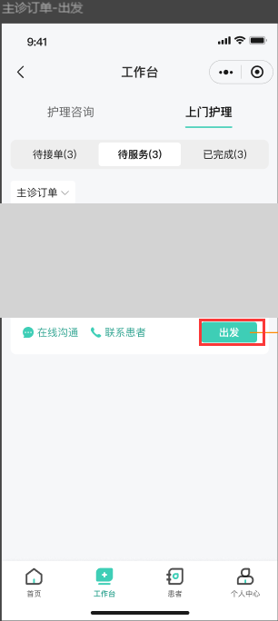
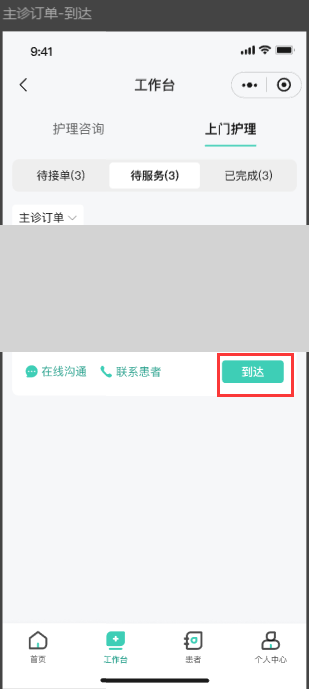
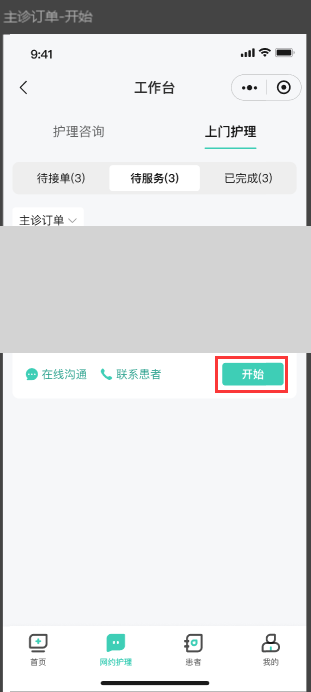
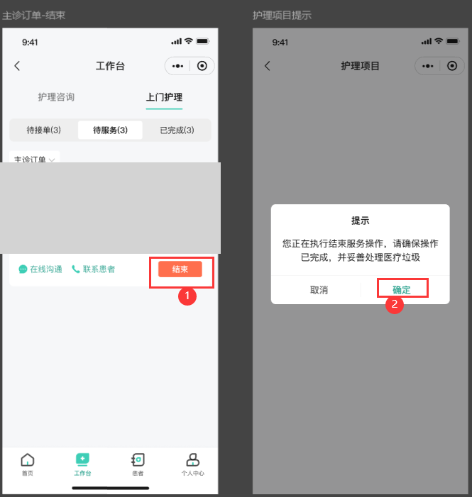

# 上门护理语音播报 · V1.0

## 业务背景

作为上门护理护士，我在点击出发、到达、开始、结束等步骤按钮并完成业务处理后，需要听到对应语音反馈，以确认操作已成功，避免重复点击或误判。

## 解决方案

1、触发方式：按钮触发【按下按钮“开始”触发语音，eg,上门护理服务“开始”语音】

2、语音播报调用。提供查询音频的接口，根据传入参数的类似去返回对应节点的音频。

3、音频存储方式：音频存表里的是一段mp3的文件地址url

4、调用阶段：出发、到达、开始、结束。各阶段的语音播报触发位置具体说明如下，

（1）出发

点击【出发】按钮触发语音播报——调用【出发的语音】“准备出发，出发前请检查准备事项”。

对应UI页面page：【主诊订单-出发】

到达

点击【到达】按钮触发语音播报——调用【到达的语音】“已到达目的地，请做好开始前准备工作”。

对应UI页面page：【主诊订单-到达】

开始

点击【开始】按钮触发语音播报——调用【开始的语音】“请开始工作”。

对应UI页面page：【主诊订单-开始】

结束

点击【结束】按钮触发二次确认弹窗，点击弹窗的【确认】按钮触发语音播报——调用【结束的语音】“服务已结束”。

对应UI页面page：【主诊订单-结束】、【护理项目提示】

