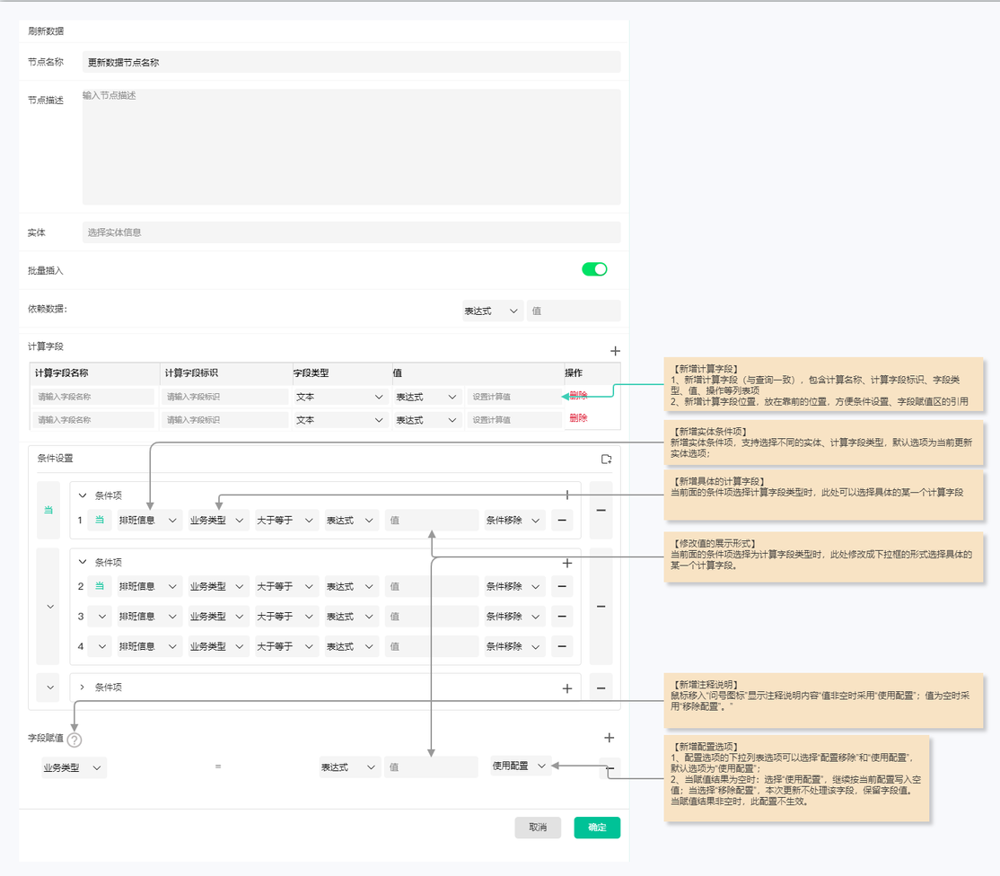

# 更新数据节点 · V1.2

## 一、业务背景

使用对象：低代码平台应用搭建人员。

应用场景：搭建人员通过【更新数据节点】修改实体记录时，部分目标字段不能直接使用固定值或上游节点输出，需要先进行运算，再将计算结果用于更新条件或字段赋值。

## 二、痛点

现有更新数据节点主要支持将常量、变量或上游节点字段直接写入目标字段，无法在当前节点内复用计算结果。

主要问题包括：

无法直接实现基于当前值的二次计算。

相同计算逻辑在条件设置和字段赋值中重复配置。

复杂计算需要额外增加流程节点，增加流程编排成本。

字段值为空时，缺少明确的保留、清空或失败处理规则。

## 三、解决方案

在现有更新数据节点中新增“计算字段”配置区域，不新增独立流程组件。

1、计算字段配置

计算字段区域放置在：依赖数据之后、条件设置之前

每条计算字段包含计算名称、计算字段标识、字段类型、值、操作等列表项，如下表所示：

| 配置项 | 说明 |
| --- | --- |
| 计算字段名称 | 用于页面展示 |
| 计算字段标识 | 当前节点内的唯一引用标识 |
| 字段类型 | 文本、数值、日期、布尔值等 |
| 值类型 | 表达式、变量、系统变量、常量、参数、节点等 |
| 值 | 具体表达式或数据内容 |

计算字段属于当前节点的临时计算结果，不属于实体真实字段，不直接保存到数据库。

2、条件项设置新增引用计算字段

当条件设置左侧的值类型选择“计算字段”类型时，右侧加载当前节点已配置的计算字段列表（即，具体的某一计算字段），段用于条件比较。

示例：

条件项类型：计算字段

字段：计算字段A

运算符：大于等于

值类型：计算字段

值：计算字段B

3、字段赋值新增引用计算字段

“=”的后面：字段赋值左侧选择需要更新的目标实体字段或者计算字段，右侧支持选择计算字段作为写入值（当前面的条件项选择为计算字段类型时，此处修改成下拉框的形式选择具体的某一个计算字段）。

4、空值处理

字段赋值增加空值处理配置，用于处理计算结果为空时的更新行为。字段赋值增加空值处理选项：使用配置、移除配置。在配置阶段，如果目标字段未选择，保存时自动移除该配置项。执行阶段，当赋值结果为空时：选择“使用配置”，继续按当前配置写入空值；当选择“移除配置”，本次更新不处理该字段，保留字段值。当赋值结果非空时，此配置不生效。

5、新增注释说明

配置选项右上方增加鼠标移入显示注释说明的交互事件。

## 四、输出成果

1、产品方案

输出产品方案文档。

2、原型

## 五、边界说明

1、本需求属于现有【更新数据节点】的功能优化，不新增独立流程节点。

2、计算字段仅在当前更新数据节点内有效，不写入实体模型。

3、计算字段不能作为实体或实体真实字段展示。

4、支持条件设置里的条件项和字段赋值引用计算字段。

5、暂不支持其他流程节点直接引用当前节点内部的计算字段。

6、计算字段标识必须唯一，字段类型需要与最终比较字段或写入字段兼容。
