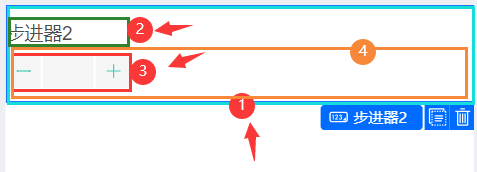
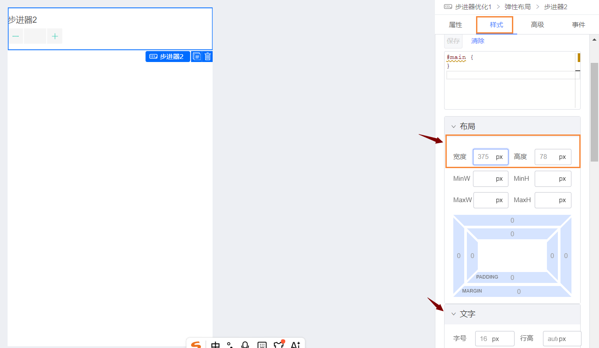
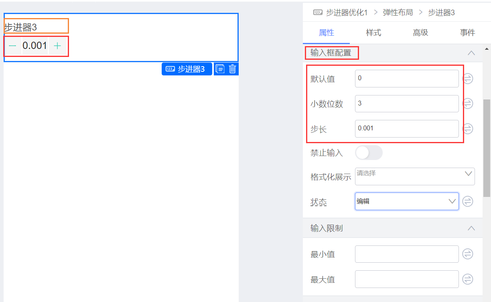
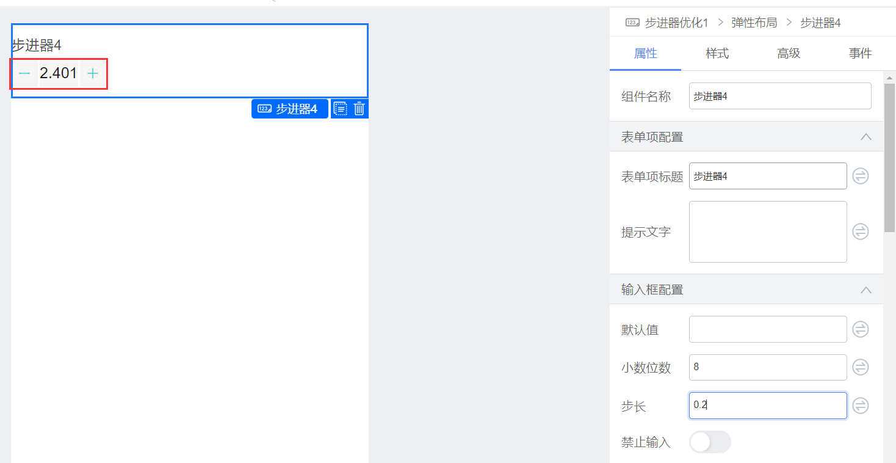
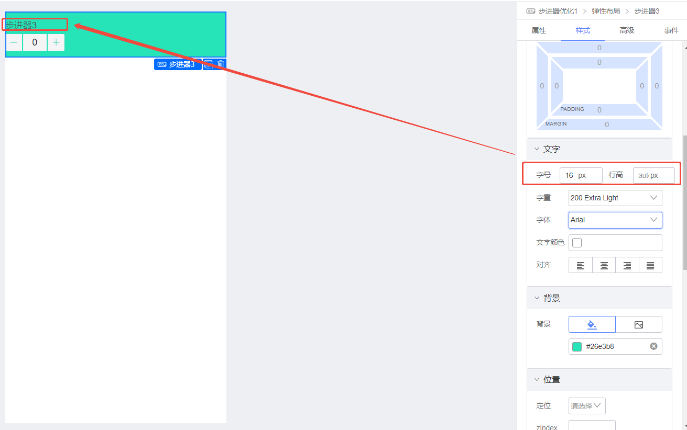
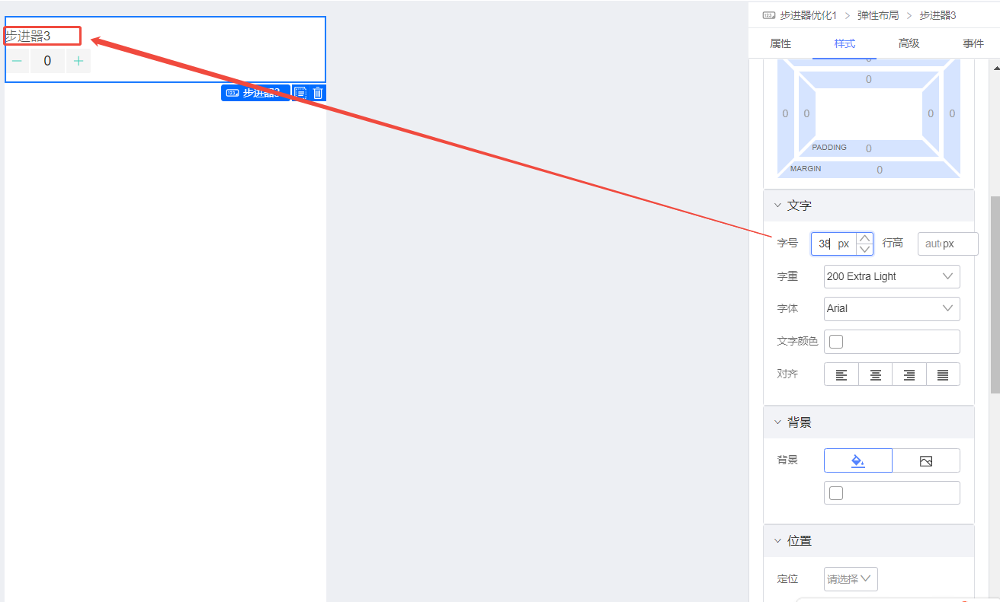
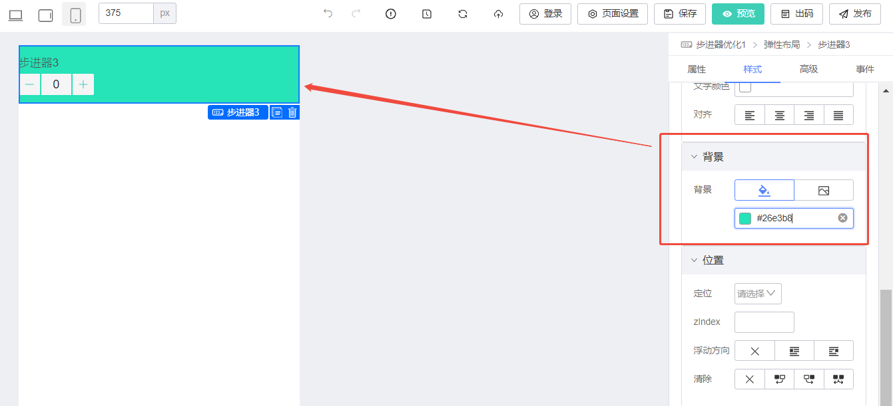

# 步进器宽高调整 · V4.2

## 业务背景

当前移动端步进器由外层表单项容器、标题区域和步进器控件组成。外层表单项宽度固定为父容器的100%（不可修改），当前样式面板中的宽度值虽然可以输入，但未实际生效；高度配置可以正常控制外层表单项高度。

当步进器展示8位及以上数字时，中间数字输入区域宽度不足，容易出现数字显示不完整的问题。需要调整步进器内部布局，使数字输入区宽度变化时，左右加减按钮能够联动移动，并在父容器宽度变化时重新计算可用宽度。

## 方案结论

1、复用现有“输入区样式—布局”面板，不新增独立的步进器尺寸配置区。

2、外层表单项容器宽度继续固定为父容器的100%。现有“宽度”配置调整为控制步进器控件整体宽度，即减号按钮、数字输入区和加号按钮组成的编号③区域。

3、减号、加号按钮保持现有固定宽高；数字输入区占用剩余空间。步进器整体宽度变化时，减号按钮位置保持不变，加号按钮跟随数字输入区右边界移动。

## 配置规则

1、面板区域和字段说明：

（1）保留原字段名称，在字段旁增加提示图标：

宽度：控制步进器控件整体宽度；

高度：控制外层表单项高度。

（2）控制规则

步进器宽度、最小宽度、最大宽度控制编号③

表单项高度、最小高度、最大高度控制编号①；

编号①宽度始终为父容器100%；

背景色继续作用于编号①外层表单项区域。

控制对象如下表所示，

| 配置项 | 控制对象 | 规则 |
| --- | --- | --- |
| 宽度、MinW、MaxW | 编号③步进器控件 | 控制减号、输入区、加号组成的整体宽度 |
| 高度、MinH、MaxH | 编号①外层表单项 | 保持当前已有逻辑 |
| 编号①外层宽度 | 编号① | 固定为父容器100%，不接受面板宽度配置 |
| 按钮宽高 | 减号、加号按钮 | 保持现有固定尺寸 |
| 数字输入区宽度 | 中间输入区域 | 系统根据编号③剩余空间自动计算 |

## 宽度联动规则

（1）步进器内部布局：【[减号按钮] [数值输入区] [加号按钮]】

（2）数值输入区宽度计算规则：

数值输入区宽度=步进器总宽度- 减号按钮宽度- 加号按钮宽度；

（3）用户修改步进器宽度或数字内容长度发生变化时：

减号按钮位置和尺寸保持不变；

数字输入区自动扩展或收缩；

加号按钮同步左右移动；

左右按钮不被压缩；

不发生按钮重叠、数字遮挡和布局错位。

默认规则：

步进器宽度默认使用auto。auto模式下：

宽度根据数字内容所需空间计算；

实际宽度不得小于现有默认宽度；

实际宽度不得超过外层可用内容区域；

短数字不导致步进器缩小到现有默认值以下；

8位及以上数字可以推动中间输入区扩展。

（5）背景色生效的范围——最外层矩形框编号①区域

（6）应用场景示例

1、步进器宽度为auto时的默认值：

宽度：100%；高度：78px；【输入框配置】默认值：0；小数位数：3；步长0.001。【表单项配置】

表单项标题：默认字体大小：16px

2、步进器宽度为auto，修改了[数值输入区]后：

当[数值输入区]：输入2.40100000，【步进器内部布局】的宽度应该自动调整自适应的宽度。

## 高度

如果字体、字号变化，auto情况下，可以自动调整【最外层矩形框编号①区域】的高度；如果需要调整【高度】，可以手动调整【高度】的值。

## 背景颜色区域

## 四、边界处理

1、当数字内容所需宽度超过外层可用区域时：

步进器整体不再扩大；数字输入区内部允许横向滚动；不显示省略号；不截断实际数值；不遮挡左右按钮。

2、已有页面中的步进器升级后继续保持原有初始宽度和高度。未配置新宽度规则的历史组件按照auto模式处理，并以现有默认宽度作为最小宽度，避免页面升级后发生视觉变化。
