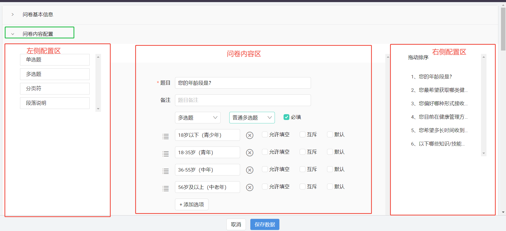
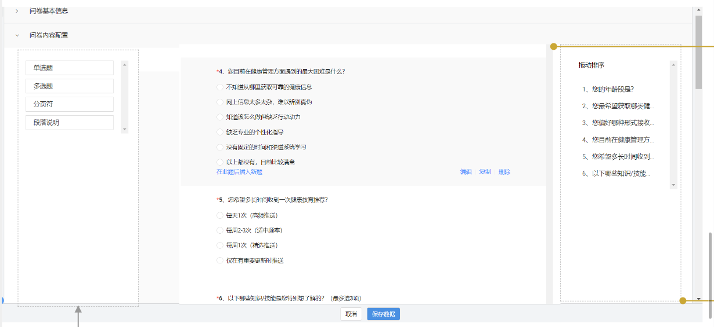
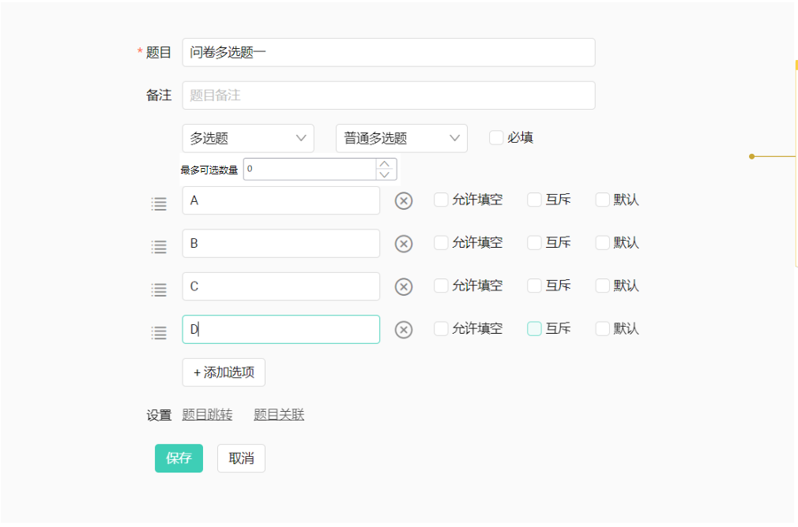
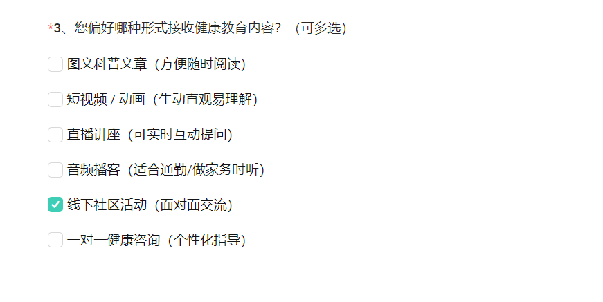
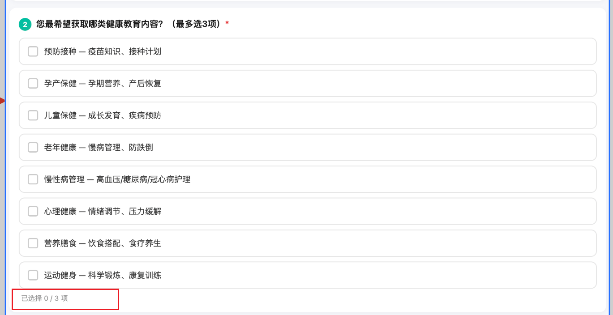
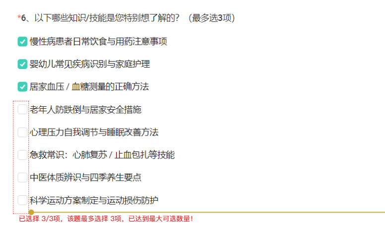

# 问卷组件改造 · V6.0

## 一、业务背景

使用对象：低代码平台应用搭建人员，以及使用移动端问卷页面进行填写的业务用户。

应用场景：搭建人员在 PC 页面中使用现有【问卷内容配置】组件完成题目编排与题目属性配置，并在移动端通过现有【问卷渲染】组件展示问卷。当前需求属于现有问卷组件能力增强，不新增独立题型组件，不改变现有问卷搭建主链路。

本次工单包含三个关联优化点：长问卷场景下左右功能区操作不便、多选题缺少最大选择数量配置、移动端缺少最大选择数量提示与限制。

## 二、痛点

1、长问卷配置时，中间题目区域随题目数量持续向下延伸，左侧【题目类型】和右侧【题目顺序】区域停留在页面顶部。搭建人员在中下部新增或配置题目时，需要频繁返回顶部操作。

2、现有【多选题】缺少“最多可选数量”配置，无法满足“10 个选项最多选择 3 项”等业务场景。

3、移动端填写多选题时，没有最大选择数量提示和限制，用户无法提前了解该题最多可以选择多少项。

## 三、解决方案

总体方案：在现有【问卷内容配置】与【问卷渲染】组件基础上进行能力增强。PC 端负责配置与保存规则，移动端负责读取并执行规则。保持老问卷默认行为不变，新增配置采用缺省兼容方式。

1、PC端问卷配置左右功能区悬浮优化

方案：当问卷题目较多、页面向下滚动时，左侧【题目类型】配置区域和右侧【题目顺序】配置区域保持在当前页面可视区域内，避免搭建人员在新增或配置题目时频繁返回页面顶部。

1）优先采用顶部吸附方式：页面向下滚动后，左右功能区保持在页面顶部可视区域，中间题目区域正常滚动。

2）问卷内容未超过当前页面高度时，保持现有布局，不触发悬浮。

| 场景 | 交互规则 |
| --- | --- |
| 问卷内容未超过页面高度 | 保持现有布局。 |
| 问卷内容超过页面高度并向下滚动 | 左右功能区保持在可视区域内，中间题目区域正常滚动。 |

场景示意：

1）问卷内容未超过页面高度

问卷内容未超过页面高度，保持现有布局。（现状：左右功能区位于顶部；中间题目区域持续向下延伸。）

2）问卷内容超过页面高度

问卷内容超过页面高度需要向下滚动时，采用顶部吸附方式。即，页面向下滚动时，左右功能区保持在当前可视区域内。

多选题新增“最多可选数量”配置

多选题新增“最多可选数量”配置，即，直接在现有【多选题】配置下方新增一行【最多可选数量】配置，不新增新的多选题类型。

1）配置位置：选择【多选题】后，在题目配置区域的【多选题】配置下方新增【最多可选数量】数字输入项。

2）配置值仅允许非负整数；为空或 0 表示不限制，大于 0 表示最多允许选择 N 项。

3）最大选择数量不得大于当前题目的有效选项数量。

4）配置值随现有问卷题目配置一起保存、读取和回显；历史问卷未配置该值时保持现有行为。

| 配置项 | 控件形式 | 规则 |
| --- | --- | --- |
| 最多可选数量 | 数字输入框/步进器 | 为空或0表示不限制；N>0表示最多选择N项。 |
| 默认值 | 0/空 | 保持现有多选题行为。 |
| 可配置上限 | 当前题目有效选项数 | 配置值不得大于当前有效选项数量。 |

数据规则：最大选择数量随现有问卷题目配置一起保存、读取和回显。字段可暂建议使用【maxSelect】，具体字段名称及存储位置由研发结合现有问卷配置结构确认。

| 字段建议 | 类型 | 兼容规则 |
| --- | --- | --- |
| maxSelect | integer | 缺失 / null / 0 = 不限制；N > 0 = 最多选择 N 项。 |

配置示意图如下图所示，在【多选题】配置下面增加“最多可选数量”

3、移动端最多选择数量提示与限制

方案：移动端【问卷渲染】读取多选题配置的【最多可选数量】，在填写过程中向用户展示规则，并在达到上限后限制继续新增选择。

未配置最大选择数量或配置为 0 时，保持现有多选题交互。

配置最多可选数量 N 后，在题目底部提示“已选择S/N项”（表示，最多选择N项，已选择S项）。

例如，配置最大选择数量3后，在题目底部提示“已选择0/3项”（表示，最多选择3项，已选择0项），如下图所示，

3）当已选数量S小于最多可选数量N 时，可继续正常选择 。

4）当已选数量S等于最多可选数量N 时，其他选项禁用（处于不可选状态），并弹窗提示“已选择 S/N项，该题最多选择 N 项，已达到最大可选数量!”；已选项仍可取消，取消后可继续选择其他选项。

| 状态 | 处理方式 |
| --- | --- |
| 未配置最大选择数量 | 保持现有多选题行为。 |
| 已选数量S < N | 正常选择。 |
| 已选数量S = N | 不允许继续新增选择，并提示“该题最多选择 N 项”。 |

## 四、边界说明

1、本需求属于现有【问卷内容配置】和【问卷渲染】组件优化，不新增独立问卷组件，不新增独立多选题型。组件优化范围如下表所示，

| 模块 | 优化内容 |
| --- | --- |
| PC【问卷内容配置】 | 长问卷场景下左右功能区保持在可视区域内。 |
| PC【问卷内容配置】-多选题 | 新增“最多可选数量”配置，并支持保存、读取和回显。 |
| PC/移动端【问卷渲染】 | 读取最大选择数量，展示提示并限制超选。 |

2、本期只新增“最多可选数量”，不同时扩展“至少选择 N 项”“固定选择 N 项”“选项互斥”等其他多选规则。

3、最大选择数量只影响前端配置、渲染和提交校验，不改变多选题答案本身的存储结构。

4、PC 左右栏悬浮只处理问卷组件内部的长页面操作，不改变低代码平台页面设计器的全局滚动规则。

5、老问卷数据必须向后兼容；无新增字段时不得出现报错、错误提示或行为变化。

## 五、输出成果

1、产品解决方案：本《问卷组件改造解决方案V6.0》。

[问卷优化一（PC端）原图](./overview-1.png)

[问卷优化三——移动端原图](./overview-2.png)

[问卷优化二（PC端）原图](./overview-3.png)

[附录：需求说明、字段与验收用例](./需求说明.md)。附录保留讨论阶段的两种限选方式，本文 V6.0 采用选满禁用。
